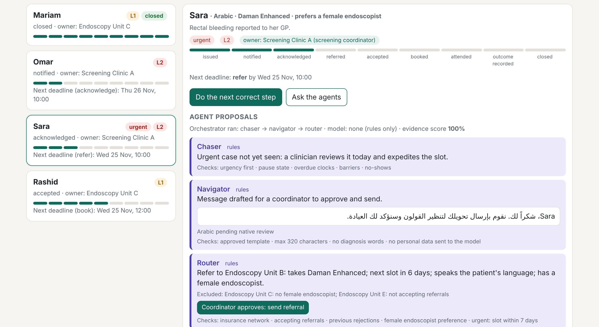
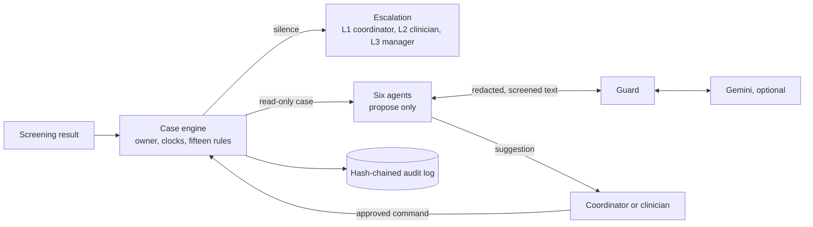

# Itmam (إتمام)

**Every actionable screening result, owned until care is complete.**

[](https://github.com/reply2vikas/itmam/actions/workflows/ci.yml)
**Live demo:** https://itmam-85431195414.europe-west3.run.app

Itmam is a prototype for the Future Health Digital Innovation Challenge, Statement 05: *Closing
the Screening-to-Care Loop*. Every actionable screening result becomes a case with exactly one
accountable owner and a clock on the next expected event. When something that should happen
does not — a message unopened, a referral not accepted, an appointment missed — Itmam notices
the silence and escalates to qualified staff. Ownership moves to another organisation only when
that organisation accepts the referral, and a case closes only with the evidence and sign-offs
its closure type requires: for example, the receiving clinician signs a recorded outcome, and
closing a case as "not actionable" needs two different clinicians.

> **All data in this repository is synthetic.** No real person's data is used anywhere.
> Synthetic identifiers start with `TEST-`; organisations are fictional.

## Status

Working prototype, submitted on 20 November 2026.

| Area | State |
| --- | --- |
| Case engine, three pathways, fifteen invariants, property-based and planted-bug tests | Done |
| Evidence ladder (closure evidence tiers T0–T4; AI text never counts as evidence) | Done |
| Loop-closure ledger: stuck point, who acts and next action for every open case; act-today list; days held by each side | Done, live |
| Premarital couple case: one case, two people, separate understanding and consent | Done, live |
| Malaffi-verified closure | Simulated: the demo uses a labelled stand-in for Malaffi; a real link needs DoH onboarding |
| Itmam Twin: what-if simulation of a FIT-positive cohort through the real engine | Done ([results](docs/simulation.md)) |
| Web demo with per-visitor sandbox, five synthetic cases, demo clock, closure and impact measures | Done, live |
| Six propose-only agents, Guard, AI governance screen, 67-case benchmark | Done, live |
| Installable web app (phone home screen) | Done |
| Held-out evaluation of live AI replies; simulation rates measured from real data | Planned for the pilot |
| Persistent database, sign-in, real system integrations | Planned for the pilot |

## Try it

Open the live demo at **https://itmam-85431195414.europe-west3.run.app** (synthetic data; AI assistance by Gemini 2.5 Flash-Lite, with a rules-only fallback), or run it on your own computer with `make run` and open `localhost:8080` in your browser (this address works only on the computer running it). Each
visitor gets a private sandbox with five synthetic cases and a demo clock, and the page opens
with a two-minute tour:



| Patient | What the demo shows |
| --- | --- |
| Mariam (Arabic, Thiqa) | The happy path, step by step, to a surveillance closure |
| Omar (English, Daman Basic) | Silence: automatic reminders, then escalation L1 → L2 → L3 |
| Sara (Arabic, urgent, prefers a female endoscopist) | Urgency first; routing that respects her preference |
| Rashid (English, Thiqa) | A missed appointment, barriers, and rebooking with support |
| Aisha & Khalid (premarital couple, Arabic) | One case, two people: each must understand and consent alone before a joint counselling session |

A **closure and impact measures** panel, computed live from the demo's cases, shows the measures Statement 05 asks for: notified, understood, referrals accepted, no-shows, overdue, escalated, closed with evidence, unresolved, and average days from result to notification, referral acceptance and closure.

A **loop-closure ledger** below it shows where every open case is stuck (not notified, not yet
understood, referral not accepted, not booked, missed appointment, evidence missing), who must
act and the next action; an **act today** list of cases whose deadline falls within 48 hours;
and the **days held** by the patient, the screening clinic and the receiving unit. All of it is
derived by rules from the case and its audit log ([`api/itmam/insights.py`](api/itmam/insights.py)).

"Try a mistake" makes the AI, the wrong unit or the wrong person attempt an unsafe action,
including using an AI-written summary as closure evidence and booking a couple's joint session
before both partners consent. The engine refuses each one and the refusal changes nothing.

### Evidence ladder and verified closure

Closure evidence carries its source, and the source sets its strength
([`api/itmam/domain/evidence.py`](api/itmam/domain/evidence.py)):

| Tier | Source | Example |
| --- | --- | --- |
| T0 | Patient's own report | "I had it done abroad" |
| T1 | Navigator or coordinator attestation | A note after a phone call |
| T2 | Record entered by the clinical team; scheduling system | The default for unlabelled records |
| T3 | Provider record; record confirmed through Malaffi | Procedure or counselling report |
| T4 | Pathology or laboratory result | Histology |

A closure that counts as success needs every piece of evidence at T2 or above, and AI-written
text is never evidence at any tier (invariant I15). In the demo, closures use a **simulated**
Malaffi lookup (`malaffi:ENC-SYN-… (simulated)`, T3) to show how verified closure would work;
there is no real Malaffi connection.

### Itmam Twin

[`api/itmam/simulation.py`](api/itmam/simulation.py) runs a synthetic FIT-positive cohort through
the real engine, with and without follow-up, using the same patients and seed (`make sim`).
Rates without follow-up are set to land near the Abu Dhabi baseline of 30.5%; every other rate
is an assumption in [`sim/parameters.yaml`](sim/parameters.yaml). Latest run: 31.5% → 47.0%
completion, no rule broken, and where open cases stall ([docs/simulation.md](docs/simulation.md)).
**It is a what-if under stated assumptions, not evidence**; only a pilot can measure the effect.

## Agents

Six agents read a case and **propose**; none of them can change it. A person applies a proposal,
and the case engine still checks all fifteen rules.

| Agent | Job | Guardrails |
| --- | --- | --- |
| Orchestrator | Runs the right agents for the case, in order; reports an evidence score and what is missing | Decides nothing clinical; logs every proposal |
| Chaser | What should happen next on a late or stuck case, and who does it | Urgent cases always go to a clinician first |
| Router | Which endoscopy unit to refer to | Insurance network, accepting referrals, no unit that already rejected, female-endoscopist preference, urgent slot within 7 days |
| Navigator | Drafts the patient message; tags barriers in free-text replies (English and Arabic) | Approved templates; no names sent to the model; drafts checked for length and diagnosis words; tags are suggestions until a coordinator approves |
| Verifier | Checks a closure before anyone signs | Placeholder evidence, evidence ladder tier, due-date range, closure type that contradicts the outcome |
| Guard | AI security for everything sent to or from a model | Prompt-injection screen (English and Arabic); Emirates ID, phone and email redaction |

**AI security and governance:** see [docs/ai-governance.md](docs/ai-governance.md). In the demo,
the **AI governance** button shows the controls and the session's AI log. `ITMAM_AI=off` is a
kill switch that runs every agent on rules only.

**Testing:** 101 automated tests, a 67-case agent benchmark (24 safety-critical cases;
[docs/agent-benchmark.md](docs/agent-benchmark.md)), 10,000 seeded random care journeys with no
rule broken, and 14 of 14 planted bugs caught. With `GEMINI_API_KEY` set (and optionally
`GEMINI_MODEL`), the Navigator uses Gemini and falls back to its rules on any failure or
guardrail breach; `python -m itmam.agents.bench --live` benchmarks that mode.

## Quick start

```bash
make install        # Python 3.11+
make test           # every test, with a quick random-journey run
make bench          # the 67-case agent benchmark
make deploy         # Cloud Run, one instance
make demo           # a narrated run: one patient reaches closure, one goes silent and escalates
make proptest       # 600 random care journeys, with statistics on how deep they go
make check          # validate the pathway files
make run            # the demo on your computer, at localhost:8080
```

## How it works



- **Pathways are configuration.** Each file in [`api/pathways/`](api/pathways) sets the clocks,
  owners, closure rules, pause rules and barrier codes for one pathway. The three prototype
  pathways are colorectal screening → colonoscopy, premarital at-risk couple → genetic
  counselling, and Well-Child developmental flag → specialist assessment. A JSON Schema
  ([`api/schema/pathway.schema.json`](api/schema/pathway.schema.json)) and a linter reject
  unsafe configurations at startup.
- **The engine is pure Python with no I/O** ([`api/itmam/domain/engine.py`](api/itmam/domain/engine.py)).
  Every command checks all its guards before changing anything, so a refused command leaves no
  trace beyond a logged refusal. Time comes from an injected clock, so tests and demo sandboxes
  can move it forward.
- **Silence is the alarm.** Each stage arms an expectation with warning and breach times. The
  clock tick warns, then escalates: coordinator queue (L1), supervising clinician (L2),
  programme manager (L3). Pauses need a reason, an approver and an automatic wake-up.
- **AI suggests, people decide.** The AI actor can only file suggestions; every state-changing
  command from it is refused.

More detail: [`docs/engine.md`](docs/engine.md). Known limits:
[`docs/assumptions-limitations.md`](docs/assumptions-limitations.md).

## The fifteen invariants

Checked after every step of every randomly generated journey ([`api/itmam/domain/invariants.py`](api/itmam/domain/invariants.py)).

| ID | Rule |
| --- | --- |
| I1 | Every open case has exactly one accountable owner, on the correct side of the hand-off |
| I2 | Every open, unpaused case has at least one armed clock |
| I3 | Every closed case carries its closure type's evidence and its required, distinct signers |
| I4 | Ownership changes only by acceptance or same-organisation reassignment |
| I5 | Every pause has a valid reason, a permitted approver and a bounded wake-up time, and stops the clocks |
| I6 | The AI actor never changes a case |
| I7 | The audit log's hash chain verifies, and every change points at its audit event |
| I8 | Every actionable result maps to exactly one case: received = open + closed |
| I9 | A closed case never changes |
| I10 | Patients only ever receive clinically approved template versions |
| I11 | A joint session (e.g. a premarital couple's counselling) is booked only when every person has given their own consent |
| I12 | The result-to-care clock is set once and never restarts: rejections, re-referrals and no-shows cannot buy time |
| I13 | Time runs forward: no event is recorded before the one logged ahead of it, so nothing can be backdated |
| I14 | No case moves past acknowledgement until every person in it has confirmed they understood |
| I15 | Closure evidence is never AI-written text, and success closures rest on evidence at tier T2 or stronger |

The property-based test ([`api/tests/test_invariants_property.py`](api/tests/test_invariants_property.py))
generates random care journeys across all three pathways — right and wrong people, the AI
actor, known mistakes at every stage, clock jumps from a minute to four months — and checks all
fifteen invariants after every step. It also asserts that every refused command changes nothing.

```bash
make proptest-10k    # one seeded batch of 10,000 journeys, about 10 minutes
make proptest-100k   # ten seeded batches of 10,000, about 100 minutes; or the "evidence" workflow
make mutation-check  # plants 14 deliberate bugs and confirms the tests catch every one
```

### Results so far

| Check | Result | Date |
| --- | --- | --- |
| 10,000 seeded journeys (`make proptest-10k`, seed 42) | Passed: 0 invariant violations (9 min 41 s, peak memory 3 GB) | 18 Oct 2026 |
| 14 planted bugs (`make mutation-check`) | 14 of 14 caught, in each of three runs | 18 Oct 2026 |
| 10,000 seeded journeys, all fifteen invariants (`make proptest-10k`, seed 42) | Passed: 0 invariant violations (4 min 52 s) | 20 Nov 2026 |
| 14 planted bugs, after adding I11–I15 | 14 of 14 caught | 20 Nov 2026 |

In the 10,000-journey run, 45% of journeys closed at least one case, 27% reached a recorded
outcome, 20% escalated a case to L3 and 19% paused and resumed one; every closure type occurred.
The submission quotes the 10,000-journey run. A 100,000-journey run (ten seeded batches of
10,000) can be reproduced with `make proptest-100k` or the "evidence" workflow.

## Repository layout

```text
api/        engine (itmam/domain), pathway files, JSON Schema, tests, FastAPI app
api/itmam/web/   the demo web app (served by the API)
api/itmam/agents/  the six agents and their benchmark
docs/       engine guide, AI governance, agent benchmark, assumptions and limitations
sim/        Itmam Twin parameters (code in api/itmam/simulation.py)
web/ eval/  notes on work planned for the pilot (no code yet)
```

## Licence

Apache-2.0 — see [LICENSE](LICENSE). Copyright 2026 Vikas Kumar Sharma.

## Mobile

Itmam installs on a phone like an app, with no store download:

- **Android (Chrome):** open the demo link, tap the menu (⋮), then **Install app** or **Add to Home screen**.
- **iPhone (Safari):** open the demo link, tap **Share**, then **Add to Home Screen**.

It opens full-screen with its own icon. Native Google Play and App Store apps are planned for the
pilot phase, after Department of Health review; store links will be added here when published.
